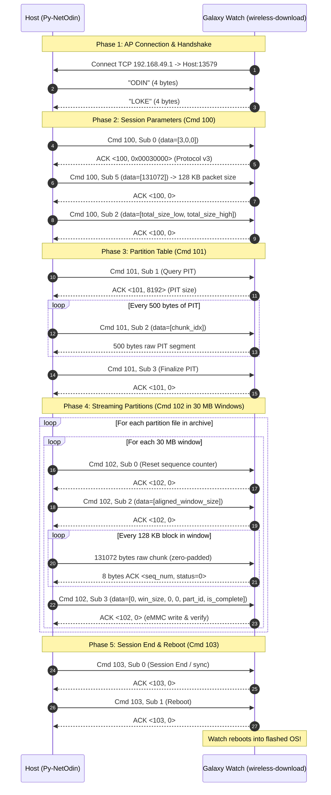

# Py-NetOdin: Native Python 3 Flasher for Samsung Galaxy Watch / Tizen Devices

A lightweight, standalone, cross-platform Python 3 implementation of the Samsung **NetOdin (LOKE over Wi-Fi)** protocol. Designed specifically for macOS (Apple Silicon `arm64` and Intel `x86_64`) and Linux environments, allowing users to flash firmware (`.tar` or `.tar.md5`) directly to Samsung smartwatches without Windows, Wine, or third-party drivers.

---

## Table of Contents
1. [Overview](#overview)
2. [Why Py-NetOdin?](#why-py-netodin)
3. [Supported Devices & Firmware](#supported-devices--firmware)
4. [Prerequisites](#prerequisites)
5. [Usage Guide](#usage-guide)
   - [Step 1: Put Watch in Wireless AP Download Mode](#step-1-put-watch-in-wireless-ap-download-mode)
   - [Step 2: Connect Host Wi-Fi to Watch](#step-2-connect-host-wi-fi-to-watch)
   - [Step 3: Run the Flasher](#step-3-run-the-flasher)
6. [Command-Line Options](#command-line-options)
7. [Protocol & Architecture Deep-Dive](#protocol--architecture-deep-dive)
   - [1. Transport & Network Layer](#1-transport--network-layer)
   - [2. Control Packet Structure (1024-byte Frame)](#2-control-packet-structure-1024-byte-frame)
   - [3. Handshake & Session Setup (Cmd 100)](#3-handshake--session-setup-cmd-100)
   - [4. PIT (Partition Information Table) Retrieval (Cmd 101)](#4-pit-partition-information-table-retrieval-cmd-101)
   - [5. Windowed Streaming & eMMC Flashing (Cmd 102)](#5-windowed-streaming--emmc-flashing-cmd-102)
   - [6. Session Termination & Reboot (Cmd 103)](#6-session-termination--reboot-cmd-103)
8. [Mermaid Sequence Flow](#mermaid-sequence-flow)

---

## Overview

Official Samsung `NetOdin3.exe` is a 32-bit Windows PE application from 2015 that relies on Windows networking APIs (Winsock) and MFC UI libraries. It does not run natively on macOS Apple Silicon or modern 64-bit Linux distributions.

**Py-NetOdin** was created by fully reverse-engineering both `NetOdin3.exe` and the watch-side receiving daemon (`wireless-download` extracted from `ramdisk-recovery.img`). It faithfully reproduces the proprietary LOKE-over-TCP protocol using standard Python 3 socket, struct, and tarfile primitives with **zero external pip dependencies**.

---

## Why Py-NetOdin?

| Feature | Official NetOdin3.exe | Py-NetOdin (This Tool) |
| :--- | :--- | :--- |
| **Platform Support** | Windows Only (32-bit x86) | macOS (Apple Silicon + Intel), Linux, Windows |
| **Dependencies** | MFC, MSVC Runtime, Wine on macOS | Python 3 standard library only (`socket`, `struct`, `tarfile`) |
| **Checksum Verification** | Basic MD5 | Streaming MD5 verification with progress feedback |
| **Windowing Engine** | 30 MB (`0x1E00000`) hardcoded | Exact 30 MB NetOdin windowing with dynamic eMMC offset calculation |
| **Chunk Alignment** | 128 KB with zero-padding | Exact 128 KB zero-padding per block |
| **PIT Table Handling** | Static parsing | Live PIT download from device + fallback mapping |
| **Automation Friendly** | GUI only (requires clicks) | Headless CLI, scriptable, auto-reboot support |

---

## Supported Devices & Firmware

- **Target Device:** Samsung Galaxy Watch 42mm / 46mm (`SM-R810`, `SM-R800`, `SM-R805`, `SM-R815`), Gear S3 (`SM-R760`, `SM-R770`), Gear Sport (`SM-R600`), and similar Tizen wearables with Wireless Download mode.
- **Firmware Formats:** Standard `.tar` and `.tar.md5` archives containing Tizen partition binaries (`sboot.bin`, `param.bin`, `dzImage`, `ramdisk.img`, `ramdisk-recovery.img`, `rootfs.img`, `system-data.img`, `user.img`, `csc.img`, `nad_fw.bin`, etc.).

---

## Prerequisites

- **Python 3.6+** installed on host machine.
- Wi-Fi adapter capable of connecting to an ad-hoc Access Point.
- Watch placed on a **wireless charging cradle** during flashing (flashing 1.6 GB over Wi-Fi takes ~8-12 minutes; keeping the watch on power prevents sleep and brownouts).

---

## Usage Guide

### Step 1: Put Watch in Wireless AP Download Mode

1. Turn off the watch.
2. Press and hold the **Power (Home)** button for ~10 seconds until **`Rebooting...`** appears at the bottom of the screen.
3. Immediately release and rapidly press the Power button 3 times to enter the **Reboot Mode Selection Menu**.
4. Single-press Power to navigate through the menu and highlight **`Download (Wireless)`**.
5. Long-press Power (~2 seconds) to select it.
6. The watch will start in WPS/Client mode. **Rapidly double-press the Power button** to switch to AP (Access Point) Mode.
7. The watch screen will display:
   ```text
   Access Point: SM-R810-xxxx
   IP: 192.168.49.1
   Please run Odin...
   ```

### Step 2: Connect Host Wi-Fi to Watch

1. On your Mac or Linux PC, open Wi-Fi settings.
2. Connect to the Wi-Fi network named **`SM-R810-xxxx`** (no password required).
3. The watch will assign your computer an IP address in the `192.168.49.x` subnet.

### Step 3: Run the Flasher

```bash
python3 netodin.py --ap AP_R810XXU1GWE2_usr.tar.md5
```

The flasher will:
1. Verify package MD5 integrity.
2. Start listening on TCP port `13579`.
3. Accept the watch's incoming connection, perform the handshake, negotiate protocol v3 and 128 KB streaming chunks.
4. Download the device's live PIT partition map.
5. Stream each partition in 30 MB windows, committing to eMMC and updating the on-watch progress bar.
6. Issue sync and auto-reboot commands upon completion.

---

## Command-Line Options

```text
usage: netodin.py [-h] --ap AP [--port PORT] [--host HOST] [--no-reboot]

NetOdin Python Flasher for Samsung Galaxy Watch / Tizen devices

options:
  -h, --help   show this help message and exit
  --ap AP      Path to firmware package (.tar or .tar.md5) [REQUIRED]
  --port PORT  TCP port to listen on (default: 13579)
  --host HOST  Host network interface to bind (default: 0.0.0.0)
  --no-reboot  Do not issue auto-reboot command to watch after flashing
```

---

## Protocol & Architecture Deep-Dive

Reconstructed from static analysis of `NetOdin3.exe` (PE32) and dynamic disassembly of the watch daemon `/usr/bin/wireless-download` (`wireless_download.elf`, ARMv7 Thumb-2).

### 1. Transport & Network Layer
- **Topology:** The watch in AP mode operates as a Wi-Fi router running `hostapd` and `dhcpd` at IP `192.168.49.1`.
- **Connection Direction:** Rather than the PC connecting to the watch, the **watch initiates an outbound TCP connection to host port 13579**. The PC must act as a TCP server listening on `0.0.0.0:13579`.
- **Low Latency Settings:** TCP sockets must have `TCP_NODELAY = 1` and `SO_KEEPALIVE = 1` enabled to prevent Nagle buffering delays during multi-megabyte transfers.

### 2. Control Packet Structure (1024-byte Frame)
Every command packet sent to the watch is exactly 1024 bytes, little-endian:

```text
+-----------------------+-----------------------+---------------------------------------+
| Field                 | Offset (Bytes)        | Description                           |
+-----------------------+-----------------------+---------------------------------------+
| cmd                   | 0x00 - 0x03 (uint32)  | Command ID (100, 101, 102, 103)       |
| sub_cmd               | 0x04 - 0x07 (uint32)  | Sub-command ID                        |
| data[0..7]            | 0x08 - 0x27 (uint32[])| Command arguments                     |
| string1               | 0x2C - 0xAB (char[128])| Latin-1 string (filename or ID)       |
| string2               | 0xAC - 0xCB (char[32])| Latin-1 secondary string              |
| padding               | 0xCC - 0x3FF          | Zero padding up to 1024 bytes         |
+-----------------------+-----------------------+---------------------------------------+
```

Responses to control packets are 8-byte status frames: `<ack_cmd: uint32, ack_status: uint32>`.

### 3. Handshake & Session Setup (Cmd 100)
1. **Magic String Handshake:** PC sends raw 4-byte ASCII `ODIN`. Watch immediately responds with `LOKE`.
2. **Protocol Negotiation (`Cmd 100, Sub 0`):** PC sends `data=[3, 0, 0]`. Watch acknowledges with status `0x00030000`, confirming protocol version 3.
3. **Chunk Size Negotiation (`Cmd 100, Sub 5`):** PC specifies packet streaming unit: `data=[131072]` (128 KB).
4. **Session Total Payload (`Cmd 100, Sub 2`):** PC transmits 64-bit total byte count of all flashable files in archive (`data=[total_low, total_high]`). If this is omitted or 0, watch UI progress function `wd_core_update_progress_bar` divides by zero (`Err: total size is invalid: 0`).

### 4. PIT (Partition Information Table) Retrieval (Cmd 101)
1. PC sends `Cmd 101, Sub 1`. Watch responds with `<101, pit_size>` (e.g. 8192 bytes).
2. PC sends `Cmd 101, Sub 2, data=[chunk_index]`. For each request, watch streams raw 500-byte PIT binary segments without control wrapper.
3. PC sends `Cmd 101, Sub 3` to finalize.
4. PC unpacks Samsung PIT binary headers (magic `0x12349876`) to map filenames (`rootfs.img`, `dzImage`, etc.) to partition IDs (`18`, `11`, etc.) dynamically.

### 5. Windowed Streaming & eMMC Flashing (Cmd 102)

#### The Watch Memory Constraint
Inside `wireless_download.elf` at function `wd_emmc_write_buffer_init` (offset `0x15368`):
```c
malloc(0x4000000); // Allocates a 64 MB (67,108,864 bytes) RAM buffer
```
At state 3 dispatch (offset `0x14160`):
```c
if (announced_size > buffer_capacity) { // > 64 MB
    wd_log("%s: Buffer overflow! (%u > %u)", announced_size, buffer_capacity);
    wd_core_close_socket(); // Aborts session and closes connection
}
```
Attempting to flash large files (e.g., `rootfs.img` 1.39 GB) in a single stream triggers this hardware overflow check.

#### The 30 MB Windowing Solution
Disassembly of `NetOdin3.exe` (`0x41d1e1` and `0x41982d - 0x419e25`) reveals the exact windowing formula:
- Windows are capped at **30 MB** (`0x1E00000` = 31,457,280 bytes), consisting of exactly **240 chunks of 128 KB**.
- For each 30 MB window:
  1. `Cmd 102, Sub 0`: Resets the watch's internal chunk sequence counter to 0.
  2. `Cmd 102, Sub 2, data=[aligned_window_size]`: Sets the expected streaming block count.
  3. Stream raw 128 KB chunks: Watch acknowledges each chunk with an 8-byte status packet `<seq, 0>`. The final chunk is zero-padded to 128 KB.
  4. `Cmd 102, Sub 3, data=[0, window_bytes, 0, 0, part_id, is_file_complete, 0, 0]`:
     - If `is_file_complete == 0`: Watch writes the 30 MB buffer to eMMC at current partition offset, advances partition write offset (`offset += window_bytes`), updates display progress, and awaits next window.
     - If `is_file_complete == 1`: Watch writes final buffer to eMMC, resets partition write offset to 0 (`offset = 0`), and prepares for next partition image.

### 6. Session Termination & Reboot (Cmd 103)
1. `Cmd 103, Sub 0`: Signals session completion. Watch calls `sync()` to flush dirty eMMC buffers and renders final progress bar tail (`wd_ui_draw_progress_bar_tail`).
2. `Cmd 103, Sub 1`: Signals auto-reboot. Watch executes `wd_sys_reboot()` and boots directly into newly flashed firmware.

---

## Mermaid Sequence Flow



---

## License

Reverse-engineered and distributed for educational, research, and non-commercial device recovery purposes. All product names, logos, and brands are property of their respective owners.
